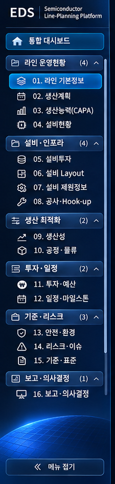

# 02. 승인된 전체 16개 메뉴와 내비게이션 동작

## 메뉴 구조: 반드시 같은 이름·번호·그룹 유지

| 그룹 | 메뉴 번호 | 이름 | URL/경로 |
|---|---|---|---|
| 라인 운영현황 | 01 | 라인 기본정보 | `line-info.html` |
| | 02 | 생산계획 | `index.html#/production` |
| | 03 | 생산능력(CAPA) | `index.html#/capacity` |
| | 04 | 설비현황 | `index.html#/equipment` (기존 `equipment.html`은 별도 보존) |
| 설비 · 인프라 | 05 | 설비투자 | `index.html#/investment` |
| | 06 | 설비 Layout | `index.html#/layout` |
| | 07 | 설비 제원정보 | `index.html#/specs` |
| | 08 | 공사 · Hook-up | `index.html#/hookup` |
| 생산 최적화 | 09 | 생산성 | `index.html#/productivity` |
| | 10 | 공정 · 물류 | `index.html#/process` |
| 투자 · 일정 | 11 | 투자 · 예산 | `index.html#/budget` |
| | 12 | 일정 · 마일스톤 | `index.html#/milestones` |
| 기준 · 리스크 | 13 | 안전 · 환경 | `index.html#/safety` |
| | 14 | 리스크 · 이슈 | `index.html#/issues` |
| | 15 | 기준 · 표준 | `index.html#/standards` |
| 보고 · 의사결정 | 16 | 보고 · 의사결정 | `index.html#/reports` |

그룹당 항목 수는 **4/4/2/2/3/1**. 메뉴의 유일한 정의는 `nav.js`의 `groups` 배열입니다. `app.js`의 `MODULES`는 각 상세 메뉴의 내용/설명을 담당하며, `line-info.html`에는 16개 메뉴를 별도 HTML로 복제하지 않습니다.

## UI 필수 규칙

- 좌측 고정 사이드바, 상단 EDS 영문 로고/서브타이틀, 홈 대시보드 파란 버튼.
- 6개 그룹은 파란 그라데이션 헤더, 폴더/카테고리 아이콘, 항목수, 펼침/접힘 화살표.
- 16개 세부 메뉴는 **각각 흰 라인형 아이콘과 번호**(예: `01. 라인 기본정보`)를 표시.
- 선택한 메뉴는 밝은 파란 배경·테두리로 강조.
- 왼쪽 네비 자체가 길면 **사이드바만 스크롤**. 메인 KPI·그래프 너비를 줄이지 않음.
- 아래에는 **메뉴 접기 / 메뉴 펼치기** 버튼. 접은 상태에서는 아이콘과 툴팁으로 접근 가능.
- HOME에서 01 클릭 시 실제 `line-info.html`, LINE INFO에서 HOME 클릭 시 `index.html`로 이동.
- 02~16은 미완성일 경우 '개발 예정' 표시. 빈 페이지 링크/404는 허용하지 않음.
- 검색·메뉴 바로가기는 기존 기능을 유지. 홈·상세 간 링크 목적지 동일.

## 승인 이미지

*참고: 이 이미지는 앞서 확정한 콘셉트 이미지에서 왼쪽 메뉴만 발췌한 디자인 기준이며 실제 화면 수치의 증거가 아닙니다.*

## 재발 방지 설계

과거에는 `app.js` 홈 메뉴와 `line-info.html` 상세 메뉴를 각각 따로 편집하여 디자인과 구성이 달라졌습니다. **v4.3은 `nav.js`와 `nav.css`를 두 페이지가 같이 불러옵니다.** 이후 수정도 이 두 파일의 한 곳에서만 합니다. HTML에서 독립 메뉴 세트를 다시 만드는 패치는 금지합니다.
